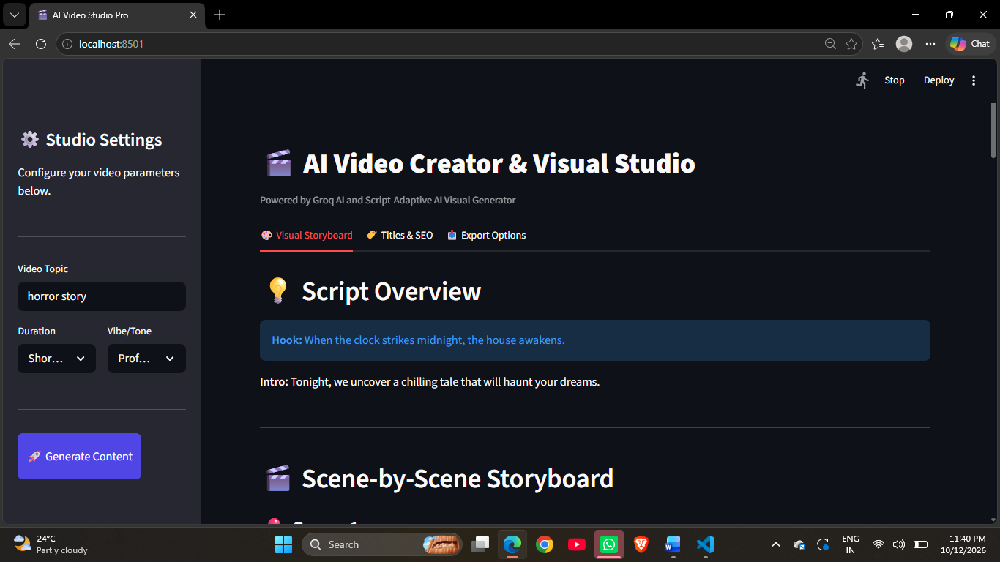

# 🎬 AI Script Generator & Video Creator Studio

An end-to-end AI Video Creation Studio built with **Streamlit** and **Python** that generates scene-by-scene scripts, voiceover narration, automated AI image visuals, and SEO metadata.

---

## 📸 Application Preview



## ✨ Key Features

- 📜 **Script & Voiceover Generation:** Generates scene-wise narration text and video scripts tailored to your topic.
- 🖼️ **AI Image Prompts & Visuals:** Automatically creates AI-generated visual previews and matching image prompts for each scene.
- 🎛️ **Studio Settings:** Customizable parameters for content genre, vibe, tone, and duration.
- 🚀 **SEO Metadata & Package Export:** Generates video metadata and exports downloadable JSON project packages.

---

## 🛠️ Tech Stack

- **Frontend:** [Streamlit](https://streamlit.io/)
- **Backend:** Python 3.x
- **AI Models:** Groq API / Llama & Image Generation APIs (`generator.py`)
- **Environment:** `python-dotenv`

---

## 📁 Project Structure

```text
ai-script-genrator/
├── app.py              # Main Streamlit web application interface
├── generator.py        # Core AI generation logic and API handlers
├── requirements.txt    # Project dependencies
├── .env                # Environment variables (API keys)
├── sample-output.png   # Application preview screenshot
└── .gitignore          # Git exclusion rules